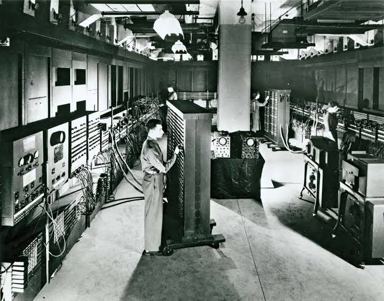
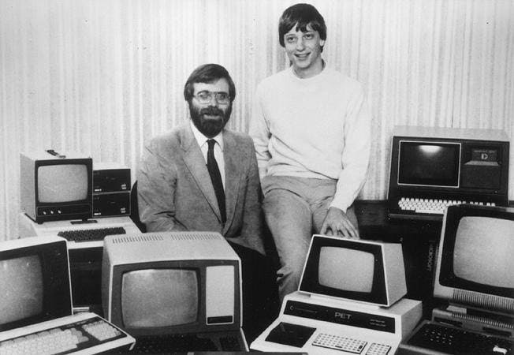
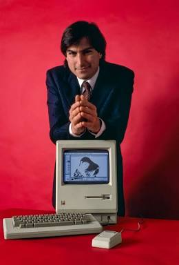
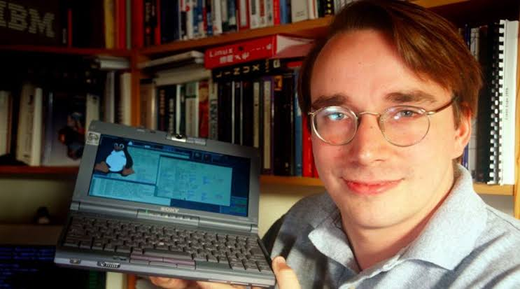
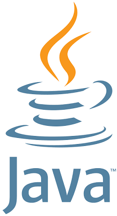

# Introdução à Computação: do Hardware ao Software

A computação nasceu da necessidade humana de automatizar o processamento de dados e resolver problemas lógicos em grande escala. Este guia percorre o caminho evolutivo em duas grandes eras tecnológicas, antes de chegar às linguagens modernas de programação.

## Sumário

1. [Primeira era: a fundação da computação](#primeira-era-a-fundação-da-computação-hardware-bruto-e-pioneirismo)
   - [As raízes mecânicas](#as-raízes-mecânicas)
   - [Ada Lovelace](#ada-lovelace-a-primeira-programadora)
   - [Alan Turing](#alan-turing-e-os-feitos-revolucionários)
   - [Os gigantes eletromecânicos e eletrônicos](#os-gigantes-eletromecânicos-e-eletrônicos)
2. [Segunda era: a democratização](#segunda-era-a-democratização-computadores-pessoais-chips-e-interfaces)
   - [O boom dos computadores pessoais (PCs)](#o-boom-dos-computadores-pessoais-pcs)
   - [A batalha dos sistemas operacionais e das interfaces gráficas (UI)](#a-batalha-dos-sistemas-operacionais-e-das-interfaces-gráficas-ui)
     - [Microsoft](#microsoft-a-democratização-comercial-e-o-domínio-do-pc)
     - [Apple](#apple-elegância-design-e-interface-humana)
     - [Linux](#linux-a-revolução-do-código-aberto-open-source)
     - [Microsoft, Apple e Linux em resumo](#microsoft-apple-e-linux-em-resumo)
   - [Como essa evolução transformou a criação de softwares e linguagens?](#como-essa-evolução-transformou-a-criação-de-softwares-e-linguagens)
3. [A evolução das linguagens de programação](#a-evolução-das-linguagens-de-programação)
4. [Marcos em resumo](#marcos-em-resumo)

## Primeira era: a fundação da computação (hardware bruto e pioneirismo)

### As raízes mecânicas

Antes da eletrônica, os conceitos de computação mecânica ganharam forma com a **Máquina Analítica de Charles Babbage**, projetada no século XIX. Seus esboços estruturais usavam engrenagens complexas.

**Curiosidade:** no campo dos dispositivos de interação primitivos, até o primeiro protótipo do mouse, criado por Douglas Engelbart, era feito de madeira.

### Ada Lovelace (a primeira programadora)

<table>
  <tr>
    <td width="30%" align="center" valign="top">
      
    </td>
    <td width="70%" valign="top">
      
Trabalhando com Babbage, Ada escreveu o <b>primeiro algoritmo da história destinado a ser processado por uma máquina</b>. Por isso, é considerada a pioneira da programação de computadores.

    </td>
  </tr>
</table>

### Alan Turing e os feitos revolucionários

<table>
  <tr>
    <td width="30%" align="center" valign="top">
      
    </td>
    <td width="70%" valign="top">
      <ul>
        <li><b>Máquina de Turing:</b> formalizou os conceitos de algoritmos e computabilidade.</li>
        <li><b>Segunda Guerra Mundial:</b> teve papel central na quebra do código nazista Enigma.</li>
        <li><b>Inteligência Artificial:</b> lançou as bases fundamentais da IA ao propor o famoso <b>Teste de Turing</b>, que avalia se uma máquina pode exibir comportamento inteligente indistinguível do humano.</li>
      </ul>
    </td>
  </tr>
</table>

### Os gigantes eletromecânicos e eletrônicos

<table>
  <tr>
    <td width="45%" align="center" valign="top">
      
    </td>
    <td width="55%" valign="top">
      <h4>Harvard Mark I (1944)</h4>
      
Um monstro eletromecânico gigantesco, baseado em relés e interruptores.

    </td>
  </tr>
  <tr>
    <td width="45%" align="center" valign="top">
      
    </td>
    <td width="55%" valign="top">
      <h4>ENIAC (1946)</h4>
      
Considerado o primeiro grande computador digital eletrônico de grande escala. Ocupava uma sala inteira, operava com milhares de válvulas a vácuo e era programado manualmente por meio de cabos e chaves físicas.

    </td>
  </tr>
</table>

## Segunda era: a democratização (computadores pessoais, chips e interfaces)

Com a invenção do transistor e, depois, do **microprocessador** (a Intel revolucionou o mercado com chips como o 4004, o 8008 e o 8080), a computação saiu dos laboratórios militares e entrou nas garagens e escritórios.

Se a primeira era foi marcada pelo hardware bruto (engrenagens, relés e válvulas), a segunda foi definida pelo **software de sistema (S.O.)** e pelas **interfaces de usuário (UI)**. Sem sistemas operacionais amigáveis, a programação continuaria restrita a elites de engenheiros controlando chaves físicas.

### O boom dos computadores pessoais (PCs)

Apple e IBM transformaram máquinas industriais em itens de uso doméstico e comercial.

### A batalha dos sistemas operacionais e das interfaces gráficas (UI)

- A evolução das **linhas de comando puras** deu espaço a **interfaces visuais** baseadas em janelas, ícones e mouse: popularizadas pela Xerox PARC, refinadas pela Apple no Macintosh e consolidadas mundialmente pela Microsoft com a evolução do Windows.
- Paralelamente, o ecossistema **open-source** consolidou o **Linux**, que se tornou a espinha dorsal de servidores e sistemas modernos.

#### Microsoft: a democratização comercial e o domínio do PC

**O início (anos 70-80)**

<table>
  <tr>
    <td width="40%" align="center" valign="top">
      
       <i>Início da Microsoft: os computadores de mesa da época.</i>
    </td>
    <td width="60%" valign="top">
      
Fundada por <b>Bill Gates</b> e <b>Paul Allen</b>, a Microsoft começou criando interpretadores <b>BASIC</b> para computadores de mesa.

      
O grande salto ocorreu quando licenciaram o <b>MS-DOS</b> (<i>Microsoft Disk Operating System</i>) para a IBM, em <b>1981</b>, tornando-o o sistema padrão dos computadores corporativos e domésticos.

    </td>
  </tr>
</table>

**A revolução do Windows**

<table>
  <tr>
    <td width="40%" align="center" valign="top">
      
       <i>Tela de boas-vindas do Windows 95, com o botão Iniciar.</i>
    </td>
    <td width="60%" valign="top">
      
Percebendo o poder das interfaces gráficas (inspiradas pelo trabalho pioneiro da <b>Xerox PARC</b>), a Microsoft lançou o <b>Windows</b>.

      <table>
        <tr><th>Fase</th><th>Versões</th><th>Característica</th></tr>
        <tr><td>Camada gráfica</td><td>Windows 1.0 a 3.11</td><td>Interface gráfica rodando sobre o DOS</td></tr>
        <tr><td>Sistema integrado</td><td>Windows 95</td><td>Sistema completo, com o DOS embutido</td></tr>
      </table>
    </td>
  </tr>
</table>

**Impacto no desenvolvimento**

A Microsoft consolidou o PC baseado na arquitetura **x86** (da Intel) como plataforma padrão para desenvolvedores. Isso criou ecossistemas de desenvolvimento massivos, como o **Visual Basic** e, depois, a plataforma **.NET** e o **C#**, e permitiu que empresas criassem softwares comerciais em larga escala para bilhões de usuários.

#### Apple: elegância, design e interface humana

**O início (anos 70-80)**

Fundada por **Steve Jobs**, **Steve Wozniak** e **Ronald Wayne** em uma garagem, a Apple revolucionou o mercado com o **Apple II** e, em **1984**, lançou o **Macintosh**.

**A experiência do usuário (UX)**

<table>
  <tr>
    <td width="30%" align="center" valign="top">
      
       <i>O Macintosh original, com teclado e mouse.</i>
    </td>
    <td width="70%" valign="top">
      
O Macintosh popularizou de vez o uso do <b>mouse</b>, das <b>janelas</b> e de <b>ícones visuais</b>, mudando o paradigma das telas pretas com linhas de comando para ambientes gráficos intuitivos.

      <table>
        <tr><th></th><th>CLI (linha de comando)</th><th>GUI (interface gráfica)</th></tr>
        <tr><td><b>Interface</b></td><td>Telas pretas com comandos digitados</td><td>Janelas, ícones e mouse</td></tr>
      </table>
    </td>
  </tr>
</table>

**Impacto no desenvolvimento**

A filosofia da Apple sempre uniu hardware e software de forma fechada e polida. Mais tarde, com a migração para o ecossistema baseado em Unix (**macOS**), a Apple se tornou a ferramenta favorita de desenvolvedores web e mobile no mundo inteiro, unindo a robustez de sistemas de servidores à elegância visual.

#### Linux: a revolução do código aberto (open source)

**O surgimento (1991)**

<table>
  <tr>
    <td width="40%" align="center" valign="top">
      
       <i>Linux rodando em um notebook, com o mascote Tux na tela.</i>
    </td>
    <td width="60%" valign="top">
      
Criado por <b>Linus Torvalds</b> como um projeto universitário de hobby, o Linux nasceu em <b>1991</b> para ser um sistema operacional estilo Unix, gratuito e de código aberto.

    </td>
  </tr>
</table>

**O poder da colaboração global**

Diferente da Microsoft e da Apple, que mantinham seus códigos fechados e proprietários, o Linux permitiu que programadores do mundo todo modificassem, melhorassem e auditassem o código-fonte livremente.

**Impacto no desenvolvimento**

O Linux mudou os rumos da computação mundial. Hoje, ele é a espinha dorsal de quase tudo:

- a grande maioria dos servidores web;
- supercomputadores;
- dispositivos embarcados;
- a infraestrutura de nuvem global (AWS, Google Cloud, Azure);
- o sistema Android nos smartphones.

É também o ambiente nativo onde a maioria das linguagens modernas (como PHP, Python e Node.js) roda e onde os servidores de aplicações Laravel são hospedados.

#### Microsoft, Apple e Linux em resumo

| | Microsoft | Apple | Linux |
|---|---|---|---|
| **Quem criou** | Bill Gates e Paul Allen | Steve Jobs, Steve Wozniak e Ronald Wayne | Linus Torvalds |
| **Marco principal** | MS-DOS (1981) e Windows 95 | Macintosh (1984) | Primeira versão (1991) |
| **Modelo** | Comercial e proprietário | Fechado, com hardware e software integrados | Código aberto (open source) |
| **Legado para o desenvolvimento** | PC x86, Visual Basic, .NET e C# | macOS (base Unix), favorito de devs web e mobile | Servidores, nuvem, supercomputadores e Android |

### Como essa evolução transformou a criação de softwares e linguagens?

| Mudança | O que aconteceu |
|---|---|
| **Da linha de comando à interface gráfica (CLI para GUI)** | Os primeiros programadores escreviam em cartões perfurados, para máquinas que rodavam uma tarefa por vez. Com os sistemas operacionais multitarefa (Windows, Mac e Linux), os softwares passaram a rodar em janelas simultâneas, exigindo linguagens capazes de lidar com eventos visuais e assincronicidade |
| **A separação entre camadas** | O avanço dos sistemas operacionais forçou a separação clara entre o sistema operacional (baixo nível), os drivers de hardware, o backend (lógica de negócios) e o frontend (interface visual) |
| **O solo fértil para os frameworks** | Graças à estabilidade dos sistemas Unix/Linux e à padronização dos PCs da Microsoft e da Apple, as linguagens puderam evoluir para abstrações altíssimas (como o PHP e o Laravel). O programador não precisa mais se preocupar com gerenciamento manual de memória nem com a comunicação direta com o processador, e foca 100% na regra de negócio do software |

## A evolução das linguagens de programação

Para dar ordens a essas máquinas, a comunicação evoluiu de códigos binários brutos até abstrações de alto nível e frameworks modernos.

### Linha do tempo

<table>
  <tr>
    <td width="17%" align="center" valign="top"><h3>1949</h3><b>Linguagem de máquina</b> <i>(binário e Assembly)</i></td>
    <td width="4%" align="center">→</td>
    <td width="17%" align="center" valign="top"><h3>Anos 50</h3><b>COBOL</b> <i>(a era comercial)</i></td>
    <td width="4%" align="center">→</td>
    <td width="17%" align="center" valign="top"><h3>Anos 60-70</h3><b>Paradigmas</b> <i>(estruturado e orientado a objetos)</i></td>
    <td width="4%" align="center">→</td>
    <td width="17%" align="center" valign="top"><h3>Anos 90</h3><b>Java, JavaScript e Python</b> <i>(a explosão moderna)</i></td>
    <td width="4%" align="center">→</td>
    <td width="16%" align="center" valign="top"><h3>2010+</h3><b>Frameworks</b> <i>(a era dos frameworks)</i></td>
  </tr>
  <tr>
    <td align="center" valign="middle"><code>0101 1100</code></td>
    <td></td>
    <td align="center" valign="middle"></td>
    <td></td>
    <td align="center" valign="middle"><b>C</b> e <b>Simula</b></td>
    <td></td>
    <td align="center" valign="middle">
       
      
    </td>
    <td></td>
    <td align="center" valign="middle"></td>
  </tr>
  <tr>
    <td align="center" valign="top"><b>Origem:</b> os primeiros programas eram inseridos diretamente em código binário (0 e 1) ou em Assembly rudimentar. O programador controlava diretamente os registradores de hardware e os endereços de memória físicos.</td>
    <td></td>
    <td align="center" valign="top"><b>Criado em 1959</b>, o COBOL (<i>COmmon Business-Oriented Language</i>) nasceu para padronizar o processamento de dados comerciais e financeiros, com uma sintaxe altamente legível, baseada no inglês corporativo.</td>
    <td></td>
    <td align="center" valign="top">Estruturaram conceitos fundamentais de lógica de escopo, modularização, tipagem e Orientação a Objetos (OOP), organizando a bagunça dos saltos de código (<code>goto</code>).</td>
    <td></td>
    <td align="center" valign="top">
      <b>Java (1995):</b> "escreva uma vez, rode em qualquer lugar", por meio da JVM.  
      <b>JavaScript (1995):</b> nascido para dar interatividade aos navegadores web.  
      <b>Python (1991):</b> legibilidade extrema do código e simplicidade da sintaxe.
    </td>
    <td></td>
    <td align="center" valign="top">Com a web hiperconectada, codificar do zero virou gargalo. Surgiram ecossistemas baseados em componentes prontos, como <b>Laravel</b> (PHP), <b>Spring Boot</b> (Java) e <b>React/Node.js</b> (JavaScript), que permitem construir aplicações corporativas completas em frações do tempo tradicional.</td>
  </tr>
</table>

## Marcos em resumo

| Período | Marco |
|---|---|
| Século XIX | Máquina Analítica de Babbage e o primeiro algoritmo, de Ada Lovelace |
| 1944 | Harvard Mark I |
| 1946 | ENIAC |
| 1949 | Linguagem de máquina e Assembly |
| 1959 | COBOL |
| Anos 60-70 | C e Simula: escopo, modularização e orientação a objetos |
| 1981 | MS-DOS licenciado para a IBM |
| 1984 | Macintosh, da Apple |
| 1991 | Python e primeira versão do Linux |
| 1995 | Windows 95, Java e JavaScript |
| 2010+ | Frameworks modernos (Laravel, Spring Boot, React/Node.js) |