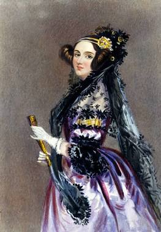
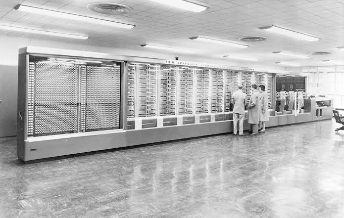
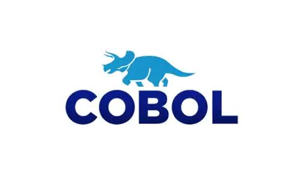
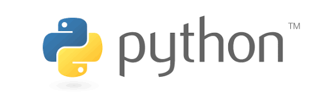
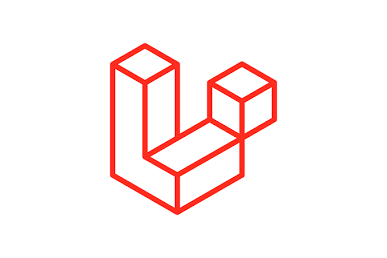

# Introdução à Computação: do Hardware ao Software

A computação nasceu da necessidade humana de automatizar o processamento de dados e resolver problemas lógicos em grande escala. Este guia percorre o caminho evolutivo em duas grandes eras tecnológicas, antes de chegar às linguagens modernas de programação.

## Sumário

1. [Primeira era: a fundação da computação](#primeira-era-a-fundação-da-computação-hardware-bruto-e-pioneirismo)
   - [As raízes mecânicas](#as-raízes-mecânicas)
   - [Ada Lovelace](#ada-lovelace-a-primeira-programadora)
   - [Alan Turing](#alan-turing-e-os-feitos-revolucionários)
   - [Os gigantes eletromecânicos e eletrônicos](#os-gigantes-eletromecânicos-e-eletrônicos)
2. [Segunda era: a democratização](#segunda-era-a-democratização-computadores-pessoais-chips-e-interfaces)
3. [A evolução das linguagens de programação](#a-evolução-das-linguagens-de-programação)
4. [Marcos em resumo](#marcos-em-resumo)

## Primeira era: a fundação da computação (hardware bruto e pioneirismo)

### As raízes mecânicas

Antes da eletrônica, os conceitos de computação mecânica ganharam forma com a **Máquina Analítica de Charles Babbage**, projetada no século XIX. Seus esboços estruturais usavam engrenagens complexas.

**Curiosidade:** no campo dos dispositivos de interação primitivos, até o primeiro protótipo do mouse, criado por Douglas Engelbart, era feito de madeira.

### Ada Lovelace (a primeira programadora)

<table>
  <tr>
    <td width="30%" align="center" valign="top">
      
    </td>
    <td width="70%" valign="top">
      
Trabalhando com Babbage, Ada escreveu o <b>primeiro algoritmo da história destinado a ser processado por uma máquina</b>. Por isso, é considerada a pioneira da programação de computadores.

    </td>
  </tr>
</table>

### Alan Turing e os feitos revolucionários

<table>
  <tr>
    <td width="30%" align="center" valign="top">
      
    </td>
    <td width="70%" valign="top">
      <ul>
        <li><b>Máquina de Turing:</b> formalizou os conceitos de algoritmos e computabilidade.</li>
        <li><b>Segunda Guerra Mundial:</b> teve papel central na quebra do código nazista Enigma.</li>
        <li><b>Inteligência Artificial:</b> lançou as bases fundamentais da IA ao propor o famoso <b>Teste de Turing</b>, que avalia se uma máquina pode exibir comportamento inteligente indistinguível do humano.</li>
      </ul>
    </td>
  </tr>
</table>

### Os gigantes eletromecânicos e eletrônicos

<table>
  <tr>
    <td width="45%" align="center" valign="top">
      
    </td>
    <td width="55%" valign="top">
      <h4>Harvard Mark I (1944)</h4>
      
Um monstro eletromecânico gigantesco, baseado em relés e interruptores.

    </td>
  </tr>
  <tr>
    <td width="45%" align="center" valign="top">
      
    </td>
    <td width="55%" valign="top">
      <h4>ENIAC (1946)</h4>
      
Considerado o primeiro grande computador digital eletrônico de grande escala. Ocupava uma sala inteira, operava com milhares de válvulas a vácuo e era programado manualmente por meio de cabos e chaves físicas.

    </td>
  </tr>
</table>

## Segunda era: a democratização (computadores pessoais, chips e interfaces)

Com a invenção do transistor e, depois, do **microprocessador** (a Intel revolucionou o mercado com chips como o 4004, o 8008 e o 8080), a computação saiu dos laboratórios militares e entrou nas garagens e escritórios.

### O boom dos computadores pessoais (PCs)

Apple e IBM transformaram máquinas industriais em itens de uso doméstico e comercial.

### A batalha dos sistemas operacionais e das interfaces gráficas (UI)

- A evolução das **linhas de comando puras** deu espaço a **interfaces visuais** baseadas em janelas, ícones e mouse: popularizadas pela Xerox PARC, refinadas pela Apple no Macintosh e consolidadas mundialmente pela Microsoft com a evolução do Windows.
- Paralelamente, o ecossistema **open-source** consolidou o **Linux**, que se tornou a espinha dorsal de servidores e sistemas modernos.

## A evolução das linguagens de programação

Para dar ordens a essas máquinas, a comunicação evoluiu de códigos binários brutos até abstrações de alto nível e frameworks modernos.

| **1949** | **Anos 50** | **Anos 60-70** | **Anos 90** | **2010+** |
|:---:|:---:|:---:|:---:|:---:|
| Linguagem de máquina | COBOL | Paradigmas (estruturado e OOP) | Java, JavaScript, Python | Frameworks modernos |
| → | → | → | → | → |

### 1. 1949: linguagem de máquina (binário e Assembly)

**Origem:** os primeiros programas eram inseridos diretamente em código binário (0 e 1) ou em linguagem Assembly rudimentar. O programador controlava diretamente os registradores de hardware e os endereços de memória físicos.

### 2. Anos 50: COBOL (a era comercial)

<table>
  <tr>
    <td width="30%" align="center" valign="middle">
      
    </td>
    <td width="70%" valign="top">
      
<b>Surgimento:</b> criado em 1959, o COBOL (<i>COmmon Business-Oriented Language</i>) nasceu para padronizar o processamento de dados comerciais e financeiros, com uma sintaxe altamente legível, baseada no inglês corporativo.

    </td>
  </tr>
</table>

### 3. Anos 60 a 70: a era dos paradigmas (estruturado e orientado a objetos)

**Surgimento:** linguagens como **C** e **Simula** estruturaram conceitos fundamentais de lógica de escopo, modularização, tipagem e Orientação a Objetos (OOP), organizando a bagunça dos saltos de código (`goto`).

### 4. Anos 90: a explosão moderna (Java, JavaScript e Python)

Uma década dourada que moldou a web e o software corporativo atual.

<table>
  <tr>
    <td width="30%" align="center" valign="middle">
      
    </td>
    <td width="70%" valign="top">
      <h4>Java (1995)</h4>
      
Focado no lema "escreva uma vez, rode em qualquer lugar", por meio da JVM.

    </td>
  </tr>
  <tr>
    <td width="30%" align="center" valign="middle">
      <b>JavaScript</b>
    </td>
    <td width="70%" valign="top">
      <h4>JavaScript (1995)</h4>
      
Nascido para dar interatividade aos navegadores web.

    </td>
  </tr>
  <tr>
    <td width="30%" align="center" valign="middle">
      
    </td>
    <td width="70%" valign="top">
      <h4>Python (1991)</h4>
      
Focado na legibilidade extrema do código e na simplicidade da sintaxe.

    </td>
  </tr>
</table>

### 5. Anos 2010 em diante: a era dos frameworks

<table>
  <tr>
    <td width="30%" align="center" valign="middle">
      
    </td>
    <td width="70%" valign="top">
      
<b>Surgimento:</b> com a web hiperconectada e sistemas complexos, codificar do zero virou gargalo. Surgiram ecossistemas robustos, baseados em componentes prontos e arquiteturas elegantes, como <b>Laravel</b> (PHP), <b>Spring Boot</b> (Java) e o ecossistema <b>React/Node.js</b> (JavaScript). Eles permitem construir aplicações corporativas completas em frações do tempo tradicional.

    </td>
  </tr>
</table>

## Marcos em resumo

| Período | Marco |
|---|---|
| Século XIX | Máquina Analítica de Babbage e o primeiro algoritmo, de Ada Lovelace |
| 1944 | Harvard Mark I |
| 1946 | ENIAC |
| 1949 | Linguagem de máquina e Assembly |
| 1959 | COBOL |
| Anos 60-70 | C e Simula: escopo, modularização e orientação a objetos |
| 1991 | Python |
| 1995 | Java e JavaScript |
| 2010+ | Frameworks modernos (Laravel, Spring Boot, React/Node.js) |