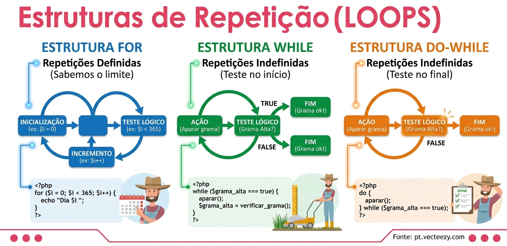

# Estruturas de Repetição (Loops)

As estruturas de repetição são os verdadeiros motores de automação do código. Elas permitem que um bloco de instruções seja executado várias vezes de forma inteligente, evitando a repetição manual de código (Clean Code).



*Fonte da imagem: pt.vecteezy.com*

## Sumário

1. [Os três tipos principais de loops](#os-três-tipos-principais-de-loops)
   - [for](#1-estrutura-for-repetição-definida)
   - [while](#2-estrutura-while-repetição-indefinida-teste-no-início)
   - [do-while](#3-estrutura-do-while-repetição-indefinida-teste-no-final)
2. [Comparativo](#comparativo)
3. [Cuidados e boas práticas cruciais](#cuidados-e-boas-práticas-cruciais)

## Os três tipos principais de loops

### 1. Estrutura `for` (repetição definida)

**Quando usar:** quando sabemos exatamente quantas vezes o bloco precisa ser executado, ou seja, quando há um limite claro.

**Anatomia:** agrupa, na mesma linha, três elementos:

| Elemento | Função | Exemplo |
|---|---|---|
| **Inicialização** | Cria a variável de controle | `$i = 1` |
| **Teste lógico (condição de parada)** | Decide se o loop continua | `$i <= 365` |
| **Incremento** | Atualiza a variável a cada volta | `$i++` |

**Exemplo prático em PHP (contando os dias do ano):**

```php
for ($i = 1; $i <= 365; $i++) {
    echo "Processando o dia: {$i}<br>";
}
```

### 2. Estrutura `while` (repetição indefinida, teste no início)

**Quando usar:** quando não sabemos quantas vezes o loop vai rodar, pois a repetição depende de uma condição que pode mudar dinamicamente. O teste lógico é feito **antes** de entrar no bloco. Se a condição for falsa de início, o código interno **nunca** é executado.

**Exemplo prático em PHP (tentativas de conexão):**

```php
$tentativas = 0;
$conectado = false;

while (!$conectado && $tentativas < 3) {
    $tentativas++;
    echo "Tentativa {$tentativas} de conexão ao banco de dados...<br>";
    // Simula sucesso na última tentativa
    if ($tentativas === 3) { $conectado = true; }
}
```

### 3. Estrutura `do-while` (repetição indefinida, teste no final)

**Quando usar:** muito parecida com o `while`, mas com uma diferença fundamental: o bloco de código é executado **obrigatoriamente pelo menos uma vez**, já que a condição de parada só é validada no final da execução.

**Exemplo prático em PHP (validação de senha):**

```php
do {
    $senhaDigitada = obterEntradaDoUsuario(); // Executa primeiro
} while ($senhaDigitada !== "1234"); // Testa depois se repete ou sai

echo "Acesso liberado!";
```

> `obterEntradaDoUsuario()` é uma função ilustrativa: representa qualquer forma de ler o que o usuário digitou.

> **Como ler o infográfico:** em todos os loops, o bloco **repete enquanto a condição é verdadeira** e **termina quando ela fica falsa**. No exemplo da grama, a condição é "a grama está alta?": enquanto sim, continua aparando; quando não, o loop termina.

## Comparativo

| | **`for`** | **`while`** | **`do-while`** |
|---|---|---|---|
| **Tipo de repetição** | Definida (sabemos o limite) | Indefinida | Indefinida |
| **Quando o teste acontece** | A cada volta, antes do bloco | No início | No final |
| **Executa ao menos uma vez?** | Não, se a condição já começar falsa | Não, se a condição já começar falsa | **Sim, sempre** |
| **Exemplo** | Contar os 365 dias do ano | Tentar conectar ao banco até 3 vezes | Pedir a senha até acertar |

## Cuidados e boas práticas cruciais

- **A condição de parada:** é o elemento mais crítico de qualquer loop. Se a variável de controle nunca alcançar o estado que encerra o ciclo (por exemplo, esquecer de incrementar `$i++`), o programa entra em **loop infinito**, consumindo recursos do sistema e podendo travá-lo.
- **Manutenibilidade:** o uso de loops otimiza o código. Se a regra de negócio interna de um processo de 365 dias precisar mudar, você altera o código em um único lugar, em vez de reescrever centenas de linhas estáticas.