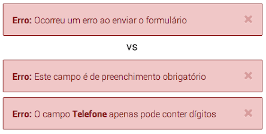
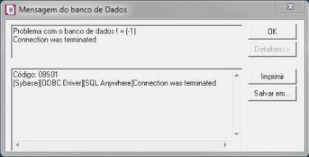
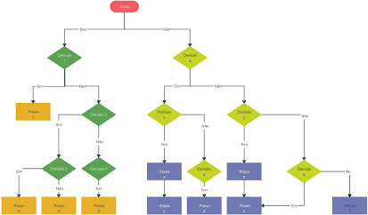

# Estruturas Condicionais e Operadores

As estruturas condicionais e os operadores formam o cérebro dinâmico de qualquer sistema. Este guia explica o que é uma condição, como escrever uma condicional em PHP, quais operadores usar para montar condições e os três tipos de estruturas de controle: simples, condicional (exceções) e lógica.

## Sumário

1. [Condição e condicional](#condição-e-condicional)
2. [Exemplo em PHP](#exemplo-em-php)
3. [Operadores comuns](#operadores-comuns)
4. [Mapa mental: operadores específicos do PHP](#mapa-mental-operadores-específicos-do-php)
5. [Tipos de estruturas de controle](#tipos-de-estruturas-de-controle)
6. [Resumo](#resumo)

## Condição e condicional

- **Condição:** representa o **estado** de algo.
- **Condicional:** expressa a **suposição** que, se verdadeira, dita o caminho que o código vai percorrer.

## Exemplo em PHP

```php
$name = "fellipe";
$college = "SENAI";

if ($name === "fellipe" && $college === "SENAI") {
    echo "competidor";
}
```

O que acontece no código:

- `$name` e `$college` guardam os valores que serão avaliados. Toda variável em PHP começa com `$`.
- `===` compara **valor e tipo**.
- `&&` exige que **as duas** condições sejam verdadeiras.
- `echo` exibe o texto. Aqui, "competidor" só aparece se o nome for "fellipe" **e** a instituição for "SENAI".

## Operadores comuns

Os operadores relacionais e lógicos mais utilizados para construir condições:

| Operador | Nome / significado | Exemplo | Descrição do retorno |
|---|---|---|---|
| `==` | Igualdade (valor) | `$a == $b` | Verdadeiro se os valores forem iguais |
| `===` | Identidade (estrito) | `$a === $b` | Verdadeiro se valores **e tipos** forem iguais |
| `!=` ou `<>` | Diferente | `$a != $b` | Verdadeiro se os valores forem diferentes |
| `!==` | Não idêntico | `$a !== $b` | Verdadeiro se valores **ou** tipos forem diferentes |
| `>` / `<` | Maior / menor que | `$a > $b` | Compara grandeza numérica ou alfabética |
| `>=` / `<=` | Maior / menor ou igual | `$a >= $b` | Verifica limite de inclusão |
| `&&` ou `and` | E lógico (conjunção) | `$a && $b` | Verdadeiro se ambas as condições forem verdadeiras |
| `\|\|` ou `or` | OU lógico (disjunção) | `$a \|\| $b` | Verdadeiro se pelo menos uma for verdadeira |
| `!` | Negação (inversão) | `!$a` | Inverte o estado booleano (`true` vira `false`) |

> **Atenção:** em PHP, a negação é feita apenas com `!`. Não existe um operador `not`. Além disso, `and` e `or` têm **precedência menor** que `&&` e `||`, o que pode mudar o resultado de uma expressão. Por isso, `&&` e `||` são os mais usados.

## Mapa mental: operadores específicos do PHP

Para ir além dos operadores matemáticos básicos (`+`, `-`, `=`), o PHP conta com ferramentas avançadas de fluxo e tipagem:


| Grupo | Operador | O que faz |
|---|---|---|
| **Identidade e comparação estrita** | `===` | Identidade: compara valor e tipo |
| | `!==` | Não identidade: valor ou tipo diferentes |
| | `<=>` | *Spaceship*: retorna `-1`, `0` ou `1` |
| **Nulidade e coalescência** | `??` | Coalescência nula: `$a ?? $b` usa `$b` se `$a` não existir ou for nulo |
| | `?->` | *Nullsafe*: evita erro ao acessar um objeto nulo |
| | `??=` | Coalescência nula de atribuição: `$a ??= $b` atribui `$b` a `$a` só se `$a` for nulo |
| **Curto-circuito e lógica** | `&&` / `and` | E lógico, com interrupção de avaliação |
| | `\|\|` / `or` | OU lógico, com interrupção de avaliação |
| **Bitwise e arrays** | `&` `\|` `^` `~` `<<` `>>` | Operadores bitwise (operam sobre os bits) |
| | `+` / `==` / `===` | Fusão e comparação de arrays |

**Curto-circuito:** a avaliação é interrompida assim que o resultado já está definido. Em `$a && $b`, se `$a` for falso, `$b` nem é avaliado.

## Tipos de estruturas de controle

Conforme a divisão estrutural, as lógicas de decisão se comportam de maneiras distintas no ciclo de vida de um sistema.

<table>
  <tr>
    <td width="45%" align="center" valign="top">
      
    </td>
    <td width="55%" valign="top">
      <h3>1. Estrutura simples</h3>
      <p>É a decisão direta que resolve um fluxo pontual e direciona o sistema para o término daquela rotina ou etapa.</p>
      <p><b>Exemplo:</b> verificar se o campo de e-mail está vazio; se estiver, exibe um alerta e encerra o fluxo da requisição.</p>
      <p>A imagem compara uma mensagem genérica ("Ocorreu um erro ao enviar o formulário") com mensagens específicas ("Este campo é de preenchimento obrigatório"). As específicas ajudam o usuário a corrigir o problema.</p>
    </td>
  </tr>
  <tr>
    <td width="45%" align="center" valign="top">
      
    </td>
    <td width="55%" valign="top">
      <h3>2. Estrutura condicional (tratamento de exceções)</h3>
      <p>Usada quando algo sai dos trilhos operacionais esperados. Em vez de seguir o fluxo normal, o sistema interrompe a execução e retorna uma <code>Exception</code> (exceção, ou erro controlado).</p>
      <p><b>Exemplo:</b> se a tentativa de conexão com o banco de dados falhar, jogue uma exceção e pare o sistema para evitar corrompimento de dados.</p>
    </td>
  </tr>
  <tr>
    <td width="45%" align="center" valign="top">
      
    </td>
    <td width="55%" valign="top">
      <h3>3. Estrutura lógica</h3>
      <p>É onde entram os operadores compostos (<code>&&</code>, <code>||</code>, <code>===</code>). Ela combina múltiplos cenários e estados de variáveis para validar regras de negócio complexas.</p>
      <p><b>Exemplo:</b> checar simultaneamente se o usuário é maior de idade, possui CPF válido e está com a matrícula ativa no SENAI.</p>
    </td>
  </tr>
</table>

## Resumo

| Estrutura | Para que serve | Exemplo |
|---|---|---|
| **Simples** | Decisão direta que encerra um fluxo pontual | Campo de e-mail vazio: exibe alerta e encerra a requisição |
| **Condicional (exceções)** | Desvio crítico: interrompe o fluxo normal e lança uma `Exception` | Falha na conexão com o banco de dados: joga uma exceção e para o sistema |
| **Lógica** | Combina vários cenários com operadores compostos | Maior de idade **e** CPF válido **e** matrícula ativa no SENAI |