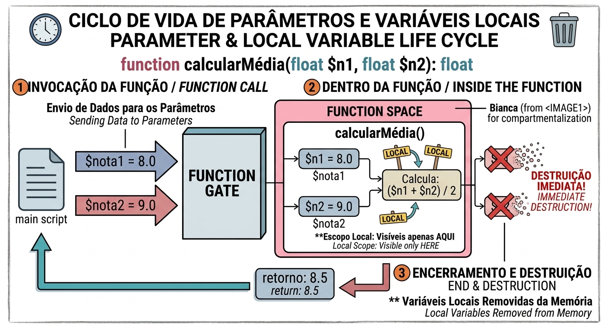

# Funções: os Pilares

Guia introdutório sobre funções na programação: os três pilares (assinatura, escopo local e invocação), o ciclo de vida dos parâmetros e das variáveis locais, e um exemplo prático em PHP.

## Sumário

1. [Os pilares de uma função](#os-pilares-de-uma-função)
   - [1. A assinatura](#1-a-assinatura-definição--nome--parâmetros)
   - [2. O escopo local](#2-o-escopo-local-privacidade-e-destruição)
   - [3. A invocação](#3-a-invocação-o-chamado)
2. [Ciclo de vida de parâmetros e variáveis locais](#ciclo-de-vida-de-parâmetros-e-variáveis-locais)
3. [Exemplo prático em PHP](#exemplo-prático-em-php)
4. [Resumo](#resumo)

## Os pilares de uma função

### 1. A assinatura (definição + nome + parâmetros)

É a **identidade** da função. Ela diz ao sistema:

- como a função **se chama**;
- quais **dados de entrada** ela espera receber (os parâmetros);
- o que ela **promete entregar de volta** (o retorno).

Veja as partes da assinatura usada no exemplo deste guia:

```php
function calcularBonusSalario(float $salarioBase): float
```

| Parte | O que é | No exemplo |
|---|---|---|
| **Definição** | A palavra-chave que declara a função | `function` |
| **Nome** | Como a função será chamada | `calcularBonusSalario` |
| **Parâmetros** | Os dados de entrada que ela espera, com o tipo | `float $salarioBase` |
| **Retorno** | O tipo de dado que ela promete devolver | `: float` |

### 2. O escopo local (privacidade e destruição)

As variáveis declaradas dentro da função pertencem **exclusivamente a ela**.

- **Ciclo de vida:** elas **nascem** quando a função é chamada e são **totalmente destruídas da memória** assim que a execução da função é encerrada.
- **Vantagem:** isso evita conflitos de nomes com o resto do código principal.

Por isso, uma variável local não pode ser usada fora da função. No exemplo deste guia, tentar usar `$bonus` no código principal gera um aviso de variável indefinida.

### 3. A invocação (o chamado)

Criar a função é apenas **guardar a receita na gaveta**. Para que ela execute, é necessário **invocá-la**: chamá-la pelo nome no código principal, passando os argumentos necessários.

## Ciclo de vida de parâmetros e variáveis locais



O infográfico usa a função `calcularMédia(float $n1, float $n2): float` e mostra três etapas:

| Etapa | O que acontece | No infográfico |
|---|---|---|
| **1. Invocação da função** | O código principal envia os dados para os parâmetros | `$nota1 = 8.0` e `$nota2 = 9.0` entram pela "porta" da função |
| **2. Dentro da função** | Os parâmetros viram variáveis locais, visíveis apenas ali, e o cálculo é feito | `$n1 = 8.0` e `$n2 = 9.0`; calcula `($n1 + $n2) / 2` |
| **3. Encerramento e destruição** | A função devolve o resultado e as variáveis locais são removidas da memória | Retorno: `8.5`; `$n1` e `$n2` são destruídas |

### Parâmetros e argumentos

| Termo | Onde aparece | No infográfico |
|---|---|---|
| **Parâmetro** | Na definição da função, como espaço reservado para o dado de entrada | `$n1` e `$n2` |
| **Argumento** | Na invocação, como o valor real que é enviado | `$nota1` e `$nota2` |

## Exemplo prático em PHP

```php
<?php

// 1. Definição da Função (Assinatura + Nome + Parâmetros + Variável Local)
function calcularBonusSalario(float $salarioBase): float {
    // $salarioBase e $bonus são VARIÁVEIS LOCAIS (morrem ao fim da função)
    $bonus = $salarioBase * 0.10; 
    
    return $salarioBase + $bonus; // Retorna o dado esperado
}

// Código Principal
$salarioAtual = 3000.00;

// 2. Invocação da Função enviando o dado
$salarioComBonus = calcularBonusSalario($salarioAtual);

echo "O novo salário é: R$ {$salarioComBonus}";
```

**Passo a passo da execução:**

| Passo | O que acontece | Valor |
|---|---|---|
| 1 | O código principal guarda o salário em `$salarioAtual` | `3000.00` |
| 2 | A função é invocada, e o argumento `$salarioAtual` vai para o parâmetro `$salarioBase` | `$salarioBase = 3000.00` |
| 3 | Dentro da função, a variável local `$bonus` recebe 10% do salário | `$bonus = 300` |
| 4 | A função retorna o salário mais o bônus | `3300` |
| 5 | `$salarioBase` e `$bonus` são destruídas. O retorno é guardado em `$salarioComBonus` | `3300` |
| 6 | O `echo` exibe a mensagem | `O novo salário é: R$ 3300` |

## Resumo

| Pilar | Pergunta que responde | No exemplo |
|---|---|---|
| **Assinatura** | Como a função se chama, o que recebe e o que devolve? | `calcularBonusSalario(float $salarioBase): float` |
| **Escopo local** | Onde as variáveis existem e por quanto tempo? | `$salarioBase` e `$bonus` só existem dentro da função |
| **Invocação** | Como e quando a função executa? | `calcularBonusSalario($salarioAtual)` |