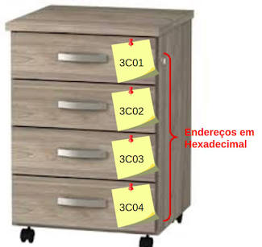
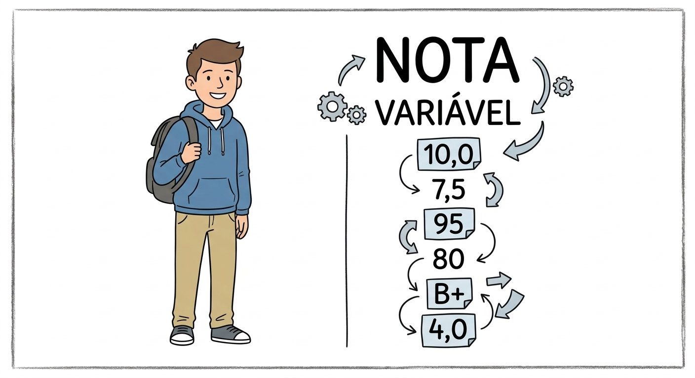
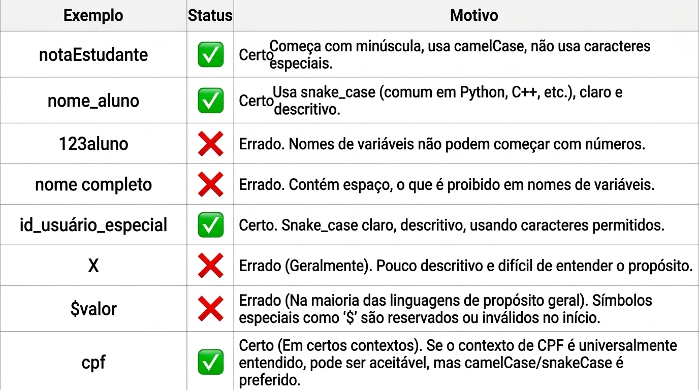

# Tipologias e Variáveis

Guia introdutório sobre os tipos de dados e as variáveis na programação: o que o computador processa, como classificar os dados, o que é uma variável, boas práticas para nomeá-las e os papéis que ela desempenha em um programa.

## Sumário

1. [A função do computador](#a-função-do-computador)
2. [Tipos de dados](#tipos-de-dados)
3. [Variáveis](#variáveis)
4. [A metáfora do armário](#a-metáfora-do-armário)
5. [Boas práticas na criação de variáveis](#boas-práticas-na-criação-de-variáveis)
6. [Tabela de validação de variáveis](#tabela-de-validação-de-variáveis)
7. [Os papéis de uma variável](#os-papéis-de-uma-variável)

## A função do computador

A principal função do computador é **processar informações** que passamos a ele. Essas informações são compostas por:

- **Dados:** os valores brutos.
- **Instruções:** normas e diretrizes lógicas usadas para manipular esses dados.

## Tipos de dados

Os dados processados podem ser classificados em três grandes tipologias:

| | **Numéricos** | **Caracteres** | **Lógicos** |
|---|---|---|---|
| **Tipos** | `int`, `float`, `decimal` | `string`, caracteres | Booleano (`bool`) |
| **Descrição** | Representam números inteiros ou números reais (com casas decimais) | Textos, palavras ou conjuntos de caracteres alfanuméricos | Valores binários de tomada de decisão |
| **Exemplos** | `10`, `3.14`, `-42`, `100.50` | `"Ana Silva"`, `"PHP 8"`, `"R$ 50,00"` | verdadeiro (1) ou falso (0) |

## Variáveis

Uma variável é uma estrutura **mutável e inconstante**: funciona como um campo na memória cujo conteúdo pode ser alterado durante a execução do programa.

**Exemplo prático:** a variável `nota01` de um estudante pode assumir valores de 1 a 10 ou de 1 a 100, e aceitar números inteiros ou reais, dependendo de como foi definida.

## A metáfora do armário

<table>
  <tr>
    <td width="40%" align="center" valign="top">
      
    </td>
    <td width="60%" valign="top">
      <h4>A variável como uma gaveta</h4>
      
Pense em uma variável como uma <b>caixa numerada ou rotulada</b> em uma seção de armários, guardando um conteúdo específico e respeitando o seu <b>tipo estrito</b> (como uma caixa etiquetada <code>string nome</code> ou <code>int nota</code>).

      
Na imagem, cada gaveta tem um <b>endereço em hexadecimal</b> (<code>3C01</code> a <code>3C04</code>). É assim que o computador localiza cada espaço na memória: o endereço identifica a gaveta, e o nome da variável é o rótulo que facilita a nossa vida.

    </td>
  </tr>
  <tr>
    <td width="40%" align="center" valign="top">
      
    </td>
    <td width="60%" valign="top">
      <h4>Exemplo: a variável <code>nota</code> de um estudante</h4>
      
Cada estudante tem uma variável <code>nota</code>. O <b>conteúdo muda</b> ao longo do programa, mas o <b>tipo</b> definido para a variável continua valendo.

      <ul>
        <li><b>Variável:</b> <code>nota</code> (estudante)</li>
        <li><b>Tipo:</b> <code>float</code> ou <code>int</code></li>
        <li><b>Valores possíveis:</b> <code>1.0</code>, <code>7.5</code>, <code>10.0</code></li>
      </ul>
      
Na imagem, a nota aparece com formatos diferentes (10,0, 7,5, 95, 80, B+, 4,0). Valores como <code>B+</code> são texto e só caberiam em uma variável definida como <code>string</code>.

    </td>
  </tr>
</table>

## Boas práticas na criação de variáveis

Para manter o código limpo, legível e em conformidade com o Clean Code, siga estas diretrizes:

- Use nomes **claros, com um ou mais caracteres descritivos**.
- **Nunca** inicie o nome de uma variável com um número.
- É **proibido** o uso de espaços em branco.
- É **vedado** o uso de palavras reservadas da linguagem (ex.: `import`, `class`, `return`).
- Pode receber combinações de letras e números, desde que respeitada a regra do primeiro caractere.

## Tabela de validação de variáveis

> **Atenção:** as regras de nomes variam conforme a linguagem. Na imagem, `$valor` aparece como errado "na maioria das linguagens", mas em **PHP** toda variável começa com `$`, então `$valor` é a forma correta.

## Os papéis de uma variável

Dentro da lógica de um programa, uma variável desempenha principalmente dois papéis funcionais:

### 1. Ação (mutabilidade do estado)

A variável serve para registrar **transformações ao longo do tempo** de execução. Ela guarda o estado atual de um processo (ex.: de `carrinho_vazio = true` para `carrinho_vazio = false`), permitindo que o sistema reaja às mudanças de cenário.

### 2. Controle (vigilância e condição)

Atua como um **parâmetro de fiscalização e guarda de fluxo**. É a variável vigiada em estruturas condicionais (como laços de repetição ou estruturas de decisão `if/else`) para ditar quando o programa deve continuar, parar ou mudar de caminho.