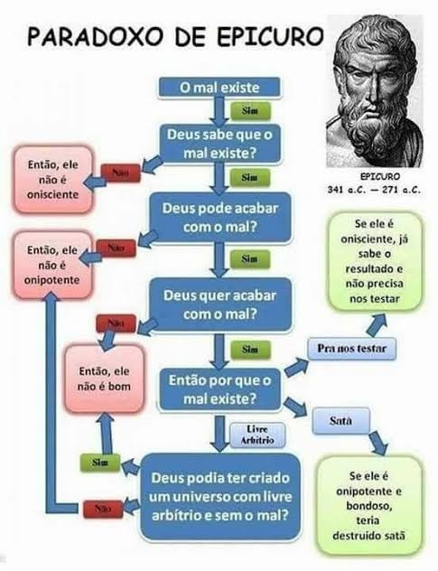

# Tipos de Lógica de Programação

Guia sobre três abordagens de lógica na programação: **linear**, **estruturada** e **modular**. Cada uma é explicada com um conceito, um exemplo do cotidiano e um código em PHP.

## Sumário

1. [Lógica linear (tradicional)](#1-lógica-linear-tradicional)
2. [Lógica estruturada](#2-lógica-estruturada)
3. [Lógica modular](#3-lógica-modular)
4. [Comparativo](#comparativo)

## 1. Lógica linear (tradicional)

**Conceito:** é a forma mais direta de execução. As instruções seguem uma linha sequencial estrita, sem desvios, laços de repetição ou estruturas condicionais. Funciona como uma lista de passos em que a linha N+1 só acontece após a conclusão da linha N.

**Exemplo prático (rotina):**

1. Acordar
2. Tomar banho
3. Tomar café da manhã
4. Ir para o trabalho
5. Ir para a faculdade (SENAI Gaspar Ricardo Júnior, Sorocaba/SP)

# Minha Rotina Diária

Aqui está uma representação visual dos passos principais da minha rotina.

<table>
  <tr>
    <!-- Passo 1 a 3: Manhã -->
    <td width="33.33%" align="center" valign="top">
      
      <br><em>Passos 1: Acordar</em>
    </td>
    <!-- Passo 4: Ir para o trabalho -->
    <!-- NOTA: Sugere-se alterar a imagem 'imagens/cafe-da-manha.jpg' para uma que represente o trajeto para o trabalho -->
    <td width="33.33%" align="center" valign="top">
      
      <br><em>Passo 3: Tomar café.</em>
    </td>
    <!-- Passo 5: SENAI -->
    <td width="33.33%" align="center" valign="top">
      
      <br><em>Passo 5: o destino final, SENAI Gaspar Ricardo Júnior.</em>
    </td>
  </tr>
</table>
A escola SENAI "Gaspar Ricardo Júnior" fica na Praça Roberto Mange, no bairro Jardim Santa Rosália, em Sorocaba/SP. Em termos visuais, a lógica linear é uma linha reta de passos sequenciais que o aluno cumpre diariamente até chegar à unidade.

**Código em PHP (linear):**

```php
<?php
// Execução sequencial direta, sem desvios
echo "1. Acordar\n";
echo "2. Tomar banho\n";
echo "3. Tomar café da manhã\n";
echo "4. Ir para o trabalho\n";
echo "5. Ir para a faculdade no SENAI Gaspar Ricardo\n";
?>
```

## 2. Lógica estruturada

**Conceito:** rompe com a rigidez linear ao introduzir estruturas de controle de fluxo, como condicionais `if/else`. Quando o programa encontra mais de uma possibilidade, ele se ramifica em caminhos lógicos diferentes, dependendo de uma condição (respostas de "Sim" ou "Não").

**Exemplo clássico (fluxograma de Epicuro, o trilema):** o famoso argumento filosófico de Epicuro sobre o problema do mal usa uma estrutura lógica condicional ramificada:

- Deus quer prevenir o mal, mas não pode? → Se sim, não é onipotente.
- Ele pode, mas não quer? → Se sim, é malevolente.

<p align="center">
  
</p>

**Exemplo cotidiano:** a lógica estruturada decide opções simples. "Vou tomar café?" → se sim, prepara a refeição; se não, pula direto para a próxima etapa.

**Código em PHP (estruturado):**

```php
<?php
// Uso de tomadas de decisão (estruturas condicionais)
$temFome = true;

if ($temFome) {
    echo "Decisão: SIM. Tomando café da manhã.\n";
} else {
    echo "Decisão: NÃO. Pulando o café e indo direto para o banho.\n";
}
?>
```

## 3. Lógica modular

**Conceito:** foca na decomposição do problema. Um sistema complexo é dividido em partes menores, independentes e reutilizáveis (chamadas de módulos, funções ou sub-rotinas). Cada bloco resolve uma subtarefa específica, facilitando a manutenção e a legibilidade do código.

**Exemplo prático:** em vez de misturar toda a rotina em um único bloco de código, dividem-se as ações em funções isoladas: `tomarBanho()`, `tomarCafe()` e `irParaFaculdade()`.


**Código em PHP (modular):**

```php
<?php
// Decomposição do problema em funções independentes (módulos)

function tomarBanho() {
    return "Módulo [Banho]: Higiene realizada com sucesso.\n";
}

function tomarCafe() {
    return "Módulo [Alimentação]: Café da manhã tomado.\n";
}

function irParaFaculdade($instituicao) {
    return "Módulo [Deslocamento]: Chegando à faculdade no $instituicao.\n";
}

// Execução chamando os módulos de forma organizada
echo tomarBanho();
echo tomarCafe();
echo irParaFaculdade("SENAI Gaspar Ricardo");
?>
```

## Comparativo

| | **Linear** | **Estruturada** | **Modular** |
|---|---|---|---|
| **Ideia central** | Sequência estrita de passos | Ramificação por condições | Divisão em partes independentes |
| **Fluxo** | Sem desvios, laços ou condicionais | Caminhos diferentes conforme "Sim" ou "Não" | Funções chamadas de forma organizada |
| **Estrutura de código** | `echo` em sequência | `if/else` | Funções (módulos) |
| **Exemplo** | Rotina: acordar até chegar à faculdade | "Vou tomar café?" | `tomarBanho()`, `tomarCafe()`, `irParaFaculdade()` |