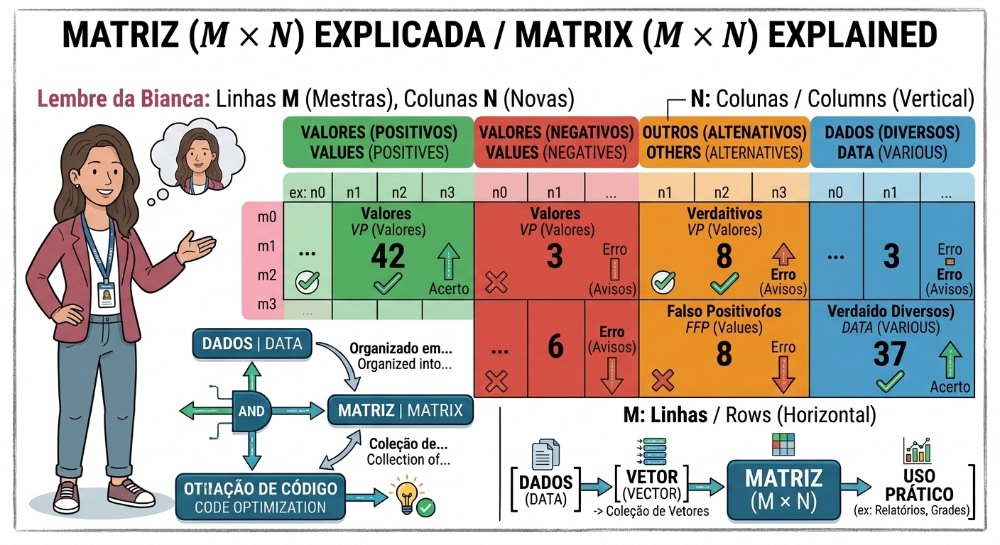

# Vetores e Matrizes na Computação

Guia de aprofundamento sobre vetores (arrays) e matrizes: como armazenam dados, como acessá-los por índices, a mnemônica para lembrar a ordem das dimensões (M × N) e um exemplo prático em PHP com as notas bimestrais de um estudante.

> **Conteúdo extra:** a diferença entre array tradicional e ArrayList e a relação com o formato JSON estão em um arquivo separado: [extra-arraylist-e-json.md](extra-arraylist-e-json.md).

## Sumário

1. [Vetores (arrays)](#1-vetores-arrays)
2. [Matrizes (tabelas M × N)](#2-matrizes-tabelas-m--n)
3. [O exemplo "codigal": a solução matricial](#3-o-exemplo-codigal-a-solução-matricial)
4. [Resumo](#resumo)

## 1. Vetores (arrays)

Os vetores são estruturas de dados **lineares** que armazenam uma sequência de dados organizados de forma contígua na memória.

- **Característica principal:** é uma variável dimensionada, com tamanho pré-fixado na maioria das linguagens tradicionais. Ou seja, você define quantos "espaços" ela terá ao ser criada.
- **Funcionamento:** cada elemento é acessado por um **índice**, geralmente começando em `0`. Um vetor de 4 posições para guardar notas tem os índices `[0]`, `[1]`, `[2]` e `[3]`.
- **Vantagem:** permite agrupar vários dados do mesmo tipo sob um único nome de variável, facilitando varreduras com estruturas de repetição, como o loop `for`.

```php
$notas = [7.5, 8.0, 9.0, 6.5];

echo $notas[0]; // 7.5 (primeira posição)
echo $notas[3]; // 6.5 (quarta e última posição)
```

| Índice | `[0]` | `[1]` | `[2]` | `[3]` |
|---|---|---|---|---|
| **Valor** | 7.5 | 8.0 | 9.0 | 6.5 |

## 2. Matrizes (tabelas M × N)

Se o vetor é uma linha reta de dados, a matriz expande esse conceito para **duas dimensões**, formando uma grade ou tabela.



### A mnemônica: "Lembre da Bianca"

Para nunca mais esquecer a ordem das dimensões, pense na matriz no formato **M × N**: primeiro as linhas, depois as colunas.

| Letra | Representa | Direção | O que define |
|---|---|---|---|
| **M** | **Linhas** (*Mestras*, na mnemônica) | Cada linha é horizontal | A **altura** da tabela: quantas linhas ela tem |
| **N** | **Colunas** (*Novas*, na mnemônica) | Cada coluna é vertical | A **largura** da tabela: quantas colunas ela tem |

### Relação fundamental

Matrizes são **coleções de vetores**. Em termos de arquitetura de software, uma matriz é um vetor em que cada posição guarda outro vetor (um **vetor de vetores**).

### Acesso aos dados

Para localizar um valor específico, usam-se **duas coordenadas** de índice:

```php
$matriz[linha][coluna]   // ou $matriz[M][N]
```

## 3. O exemplo "codigal": a solução matricial

Imagine que você precisa processar as quatro notas bimestrais de um estudante. A abordagem tradicional e repetitiva exigiria quatro variáveis soltas:

`$n1`, `$n2`, `$n3`, `$n4`

Isso polui o código e dificulta a aplicação de fórmulas matemáticas em massa. Em vez de gerenciar quatro variáveis desconexas, você pode estruturar uma **matriz 2 × 2** (que totaliza 4 campos de armazenamento):

```php
// Matriz 2x2 representando as 4 notas bimestrais organizadas em grade
$notasBimestrais = [
    [7.5, 8.0], // Linha 0: 1º e 2º Bimestre
    [9.0, 6.5]  // Linha 1: 3º e 4º Bimestre
];

// A partir daqui, arquitetar os cálculos de média fica muito mais dinâmico 
// usando loops para percorrer as linhas e colunas de forma automatizada!
```

### Acessando cada nota

| | **Coluna 0** | **Coluna 1** |
|---|---|---|
| **Linha 0** | `$notasBimestrais[0][0]` = 7.5 (1º bimestre) | `$notasBimestrais[0][1]` = 8.0 (2º bimestre) |
| **Linha 1** | `$notasBimestrais[1][0]` = 9.0 (3º bimestre) | `$notasBimestrais[1][1]` = 6.5 (4º bimestre) |

### Percorrendo a matriz com loops

Um loop dentro de outro percorre as linhas e, em cada linha, as colunas:

```php
$soma = 0;

foreach ($notasBimestrais as $linha) {
    foreach ($linha as $nota) {
        $soma += $nota;
    }
}

$media = $soma / 4;
echo $media; // 7.75
```

## Resumo

| | **Vetor** | **Matriz** |
|---|---|---|
| **Dimensões** | 1 (linear) | 2 (linhas × colunas) |
| **Acesso** | `$vetor[índice]` | `$matriz[linha][coluna]` |
| **Estrutura** | Sequência de valores | Vetor de vetores |
| **Exemplo** | `[7.5, 8.0, 9.0, 6.5]` | `[[7.5, 8.0], [9.0, 6.5]]` |